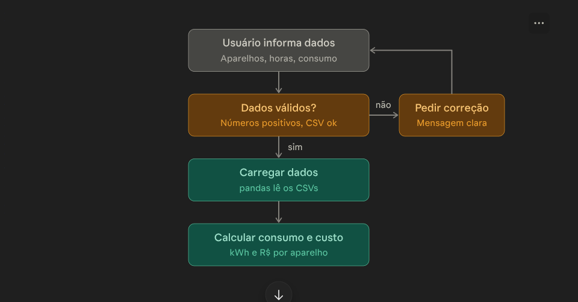
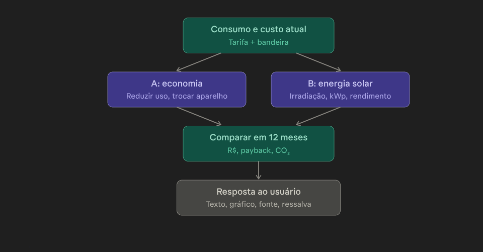
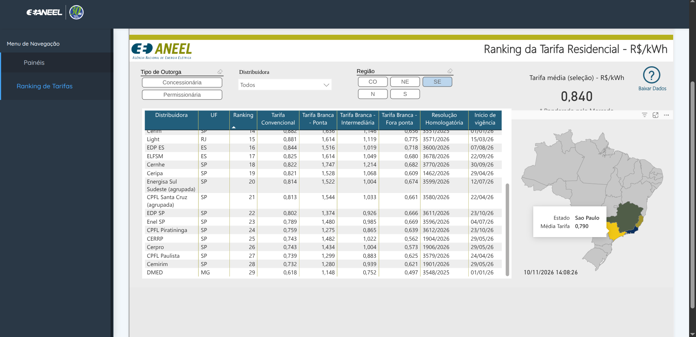
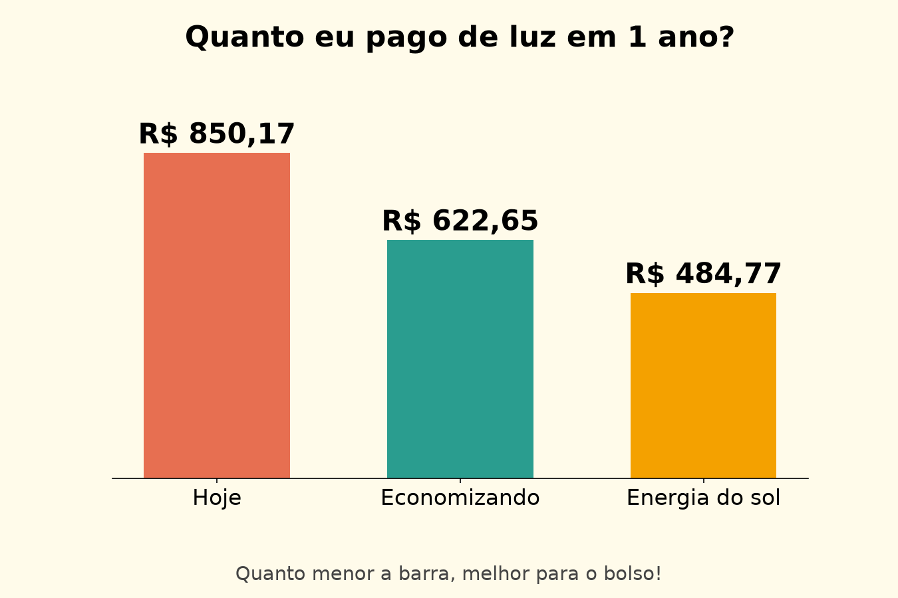
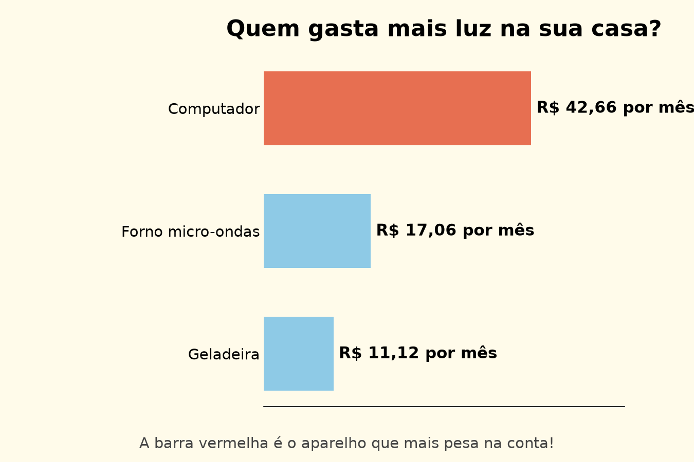
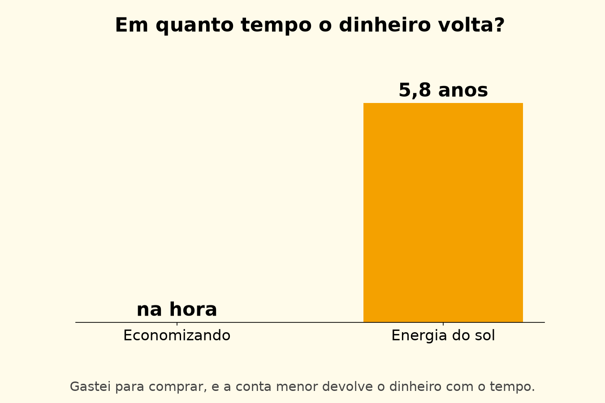
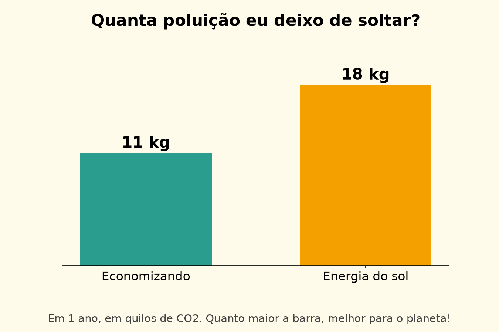

# AcessoFácil Energy — contribuição de Energia ao Citizen Assist AI


## 1. Integrantes

| Nome completo | RM |
|---|---|
| Andre shiguematsu | 569158|
| Guilherme belo| 570079 |


## 2. Público e problema

- **Público:** moradores de casas e apartamentos (cidade de referência: São Paulo/SP) com conta de luz alta e pouca informação sobre o que mais consome.
- **Necessidade energética:** entender onde está o consumo e decidir entre reduzir o gasto da casa ou gerar a própria energia.
- **Contribuição do assistente:** o usuário informa aparelhos, horas de uso e consumo mensal (kWh); o assistente explica, em linguagem simples, onde está o desperdício e compara duas alternativas.

## 3. Funcionalidades de energia

O programa funciona por menu no terminal:

1. **Consultar um aparelho:** potência e preço mediano do substituto.
2. **Consultar a tarifa:** R$ 0,790/kWh (ANEEL).
3. **Simular a conta mensal:** consumo em kWh por aparelho, com bandeira tarifária opcional (Amarela, Vermelha P1 ou P2; a Verde não tem adicional).
4. **Alternativa A (economia):** reduzir as horas de uso ou trocar por um modelo eficiente (lâmpada LED, geladeira e ar-condicionado inverter).
5. **Alternativa B (energia solar):** sistema fotovoltaico residencial dimensionado pelo consumo.
6. **Comparação em 12 meses** da situação atual, da alternativa A e da B (custo, viabilidade e impacto ambiental), com **4 gráficos** feitos.

Toda resposta traz a **fonte** dos dados e a **ressalva** de que os valores são estimativas.

**Fluxograma do programa**





## 4. Dados utilizados

| Arquivo | Conteúdo | Fonte | Tratamento |
|---|---|---|---|
| `Data/aparelhos_consumo_energia.csv` | 15 aparelhos e 4 produtos substitutos. Colunas: `nome`, `potencia_W`, `horas_por_dia`, `dias_uso_mes`, `quantidade`, `categoria` (`eletrodomestico`, `iluminacao` ou `substituto`) e `preco_mediana_RS` (só para os substitutos) | Cartilha CEMIG e `tabela_consumo.pdf` (pasta `Documents/`); preços: pesquisa em lojas (seção 6.1) | Montado manualmente. Potência e horas são **médias informadas nos PDFs** (estimadas). O preço é a mediana de três lojas; menor e maior preço, links e data estão na seção 6.1. Observações de uso na seção 6.2. |
| `Data/bandeira_tarifaria_adicional.csv` | Adicional por bandeira em R$/MWh, vigências de 2015 a 2024 (27 linhas) | ANEEL, Dados Abertos: https://dadosabertos.aneel.gov.br/dataset/bandeiras-tarifarias | Sem redução. Conversão para R$/kWh (÷ 1.000). A vigência mais recente do arquivo é 01/04/2024; confirmar se há valores mais novos. |
| `taxa_tafifaria.csv` (bruto) | 65.771 linhas de tarifas homologadas das distribuidoras | ANEEL, Dados Abertos (conjunto de tarifas das distribuidoras; https://dadosabertos.aneel.gov.br/dataset/tfsee) | Usado só para exploração e **não incluído no repositório** (cerca de 19 MB). Ver seção 5. |
| `Data/tarifa_media_sp.csv` | **R$ 0,790/kWh**, "ponderado pelo mercado" (seleção: São Paulo) | ANEEL, Luz na Tarifa: https://portalrelatorios.aneel.gov.br/luznatarifa/rankingtarifas | Valor único usado como tarifa base. 08/11/2026, filtros usados: Região SE (Sudeste) , Media Ponderada da tarifa do estado de São Paulo.
 

## 5. Redução de dados do arquivo bruto de tarifas

O arquivo bruto era grande e difícil de manipular, e a leitura inicial no Orange com vírgula como separador quebrou colunas (o arquivo usa `;` e vírgula decimal).


### 5.1 Uso no projeto

O arquivo de tarifas por distribuidora foi usado apenas para exploração. Ele apresentou vigências antigas ou encerradas e valores de TE inconsistentes entre linhas parecidas, então **não é usado nos cálculos**. A tarifa base do projeto é o valor de **R$ 0,790/kWh** do ranking da ANEEL (Luz na Tarifa).

## 6. Premissas

| Variável | Valor | Unidade | Fonte | Estimado? |
|---|---|---|---|---|
| Tarifa base | 0,790 | R$/kWh | ANEEL, Luz na Tarifa (média ponderada, São Paulo) | Não, mas confirmar filtros e impostos |
| Adicional de bandeira | ver `bandeira-tarifaria-adicional.csv` | R$/MWh (÷ 1.000 → R$/kWh) | ANEEL, Dados Abertos | Não |
| Irradiação solar, plano horizontal | 4,45 | kWh/m²/dia | CRESESB SunData, São Paulo (lat. 23,5475°S, long. 46,6361°O) | Não |
| Irradiação solar, inclinação = latitude (24°N) | 4,65 | kWh/m²/dia | CRESESB SunData, São Paulo | Não |
| Irradiação solar, maior média anual (21°N) | 4,66 | kWh/m²/dia | CRESESB SunData, São Paulo | Não |
| Custo de instalação solar | 2 kWp: R$ 10.000–14.000; 4 kWp: R$ 16.000–22.000; 8 kWp: R$ 30.000–40.000 | R$ | Olhar Digital (17/05/2026); a matéria não informa a fonte da tabela | Sim |
| Payback citado | 4 a 6 anos | anos | Olhar Digital (17/05/2026) | Sim |
| Preço da geladeira inverter (substituta) | 2.899,00 (mediana de 3 lojas) | R$ | Pesquisa em lojas, 08/11/2026 (seção 6.1) | Sim |
| Preço do ar-condicionado inverter 12.000 BTU (substituto) | 2.733,00 (mediana de 3 lojas) | R$ | Pesquisa em lojas, 08/11/2026 (seção 6.1) | Sim |
| Preço da lâmpada LED 9 W | 3,85 (mediana de 3 lojas) | R$ | Pesquisa em lojas, 08/11/2026 (seção 6.1) | Sim |
| Preço da lâmpada fluorescente compacta 15 W | 7,90 (mediana de 3 lojas) | R$ | Pesquisa em lojas, 08/11/2026 (seção 6.1) | Sim |
| Rendimento do sistema solar | 80% (cenários: 75% / 80% / 85%) | % | Hipótese de projeto, não é valor medido | Sim |
| Consumo mínimo faturado (custo de disponibilidade) | 50 (ligação bifásica) | kWh/mês | Premissa; confirmar na conta de luz | Sim |
| Fio B (Lei 14.300/2022) | **não incluído** (60% em 2026 para sistemas novos) | — | Lei 14.300/2022 | Sim |
| Fator de emissão de CO₂ | 0,0385 (média do SIN em 2023) | kg CO₂/kWh | MCTI/SIRENE, citado por Cenário Energia (15/02/2024) | Não |
| Dias de uso por mês | valor do CSV (30 na maioria) | dias | Cartilha CEMIG | Sim |
| Geração solar | kWp × irradiação mensal × dias do mês × rendimento | kWh/mês | CRESESB SunData (12 valores mensais, inclinação = latitude) | Sim |

Consultas feitas em 08/11/2026. Os prints do SunData estão em `docs/sundata_sao_paulo_irradiacao.png` e `docs/sundata_estacoes_proximas.png`.

### 6.1 Pesquisa de preços (consulta em 08/11/2026)

Mediana de três lojas por item (valor central dos três preços ordenados). Preços de varejo mudam com promoções e estoque; a consulta é datada.

| Produto (substituto) | Menor preço | Mediana | Maior preço | Lojas consultadas |
|---|---|---|---|---|
| Geladeira inverter | R$ 2.549,00 | R$ 2.899,00 | R$ 3.509,91 | [Ramsons](https://www.ramsons.com.br/eletrodomesticos/refrigeradores/frostfree2portas), [Atacadão dos Eletros](https://www.atacadaodoseletros.com.br/eletrodomesticos/geladeira-refrigerador/2-portas/), [Lojas Guaibim](https://www.lojasguaibim.com.br/eletrodomesticos/geladeira/geladeira-duplex) |
| Ar-condicionado split inverter 12.000 BTU | R$ 1.782,04 | R$ 2.733,00 | R$ 3.182,49 | [Dufrio](https://www.dufrio.com.br/), [iByte](https://www.ibyte.com.br/ar-e-ventilacao/ar-condicionado/12000%20btus/Split?PS=24&map=c,c,specificationFilter_490,specificationFilter_489), [Gree](https://loja.gree.com.br/c/ar-condicionado-12-000-btus/) |
| Lâmpada LED 9 W | R$ 2,99 | R$ 3,85 | R$ 4,99 | [Casa Luma](https://lojacasaluma.com/produtos/lamp-led-bul-9w/), [Anhanguera Ferramentas](https://www.anhangueraferramentas.com.br/produto/lampada-led-bulbo-9w-6500k-bivolt-20031-ourolux-109539), [Leroy Merlin](https://www.leroymerlin.com.br/iluminacao/lampada/lampadas-ver-todos/lampada-led-bulbo-luz-branca-9w-p.html) |
| Lâmpada fluorescente compacta 15 W | R$ 7,87 | R$ 7,90 | R$ 10,90 | [Anhanguera Ferramentas](https://www.anhangueraferramentas.com.br/produto/lampada-fluorescente-compacta-15w-6500k-duluxstar-t3-3u-osram-106776), [Ferreira Costa](https://www.ferreiracosta.com/produto/167102/lampada-fluorescente-compacta-3u-15w-branca-e27-220v-glight), [Magazine Luiza](https://www.magazineluiza.com.br/lampada-fluorescente-15w-taschibra/p/bjkdj916a7/cj/lpfl/) |

**Equivalência das lâmpadas:** segundo o guia do Idec, uma incandescente de 60 W equivale a uma fluorescente compacta de 15 W e a um LED de 9 W (fluxo luminoso semelhante).

**Limitações dos preços:**
- Vários links são páginas de listagem ou da loja, e não de um produto único; os preços podem mudar.
- O ar-condicionado não inclui custo de instalação.
- Falta registrar, para a geladeira e o ar-condicionado inverter, o consumo em kWh/mês da etiqueta do Inmetro/Procel do modelo comparado.

### 6.2 Observações sobre o CSV de aparelhos

- **Geladeira:** fica conectada 24 h por dia, mas o consumo é estimado com 15 h/dia equivalentes de compressor (450 h/mês ÷ 30, exemplo da cartilha). Não se considera o compressor ligado 24 h.
- **Aspirador de pó:** 20 minutos por dia (≈ 0,33 h), 30 dias por mês.
- **Máquina de lavar roupas:** o exemplo da cartilha usa 12 horas de uso no mês (1 h/dia em 12 dias).
- **Lâmpadas:** incandescente, fluorescente compacta e LED são tecnologias alternativas para o mesmo ponto de luz. Compare uma com a outra, sem somar as três.
- **Ar-condicionado:** 8 h por dia em todos os dias do mês é uma média da cartilha; na prática o uso varia ao longo do ano.

## 7. Cálculos e comparação das alternativas

Todos os cálculos estão em `main.py` e comparam os **mesmos 12 meses**, com consumo, tarifa e bandeira constantes.

**Fórmulas**

- Consumo do aparelho: `kWh/mês = potência (W) × horas/dia × dias/mês × quantidade ÷ 1000`
- Custo: `R$/mês = kWh × (tarifa + adicional da bandeira)`. O adicional vem em R$/MWh no CSV e é dividido por 1000.
- **Alternativa A:** `kWh economizados = consumo atual − consumo novo` (menos horas de uso ou troca do aparelho). Investimento = preço mediano do substituto × quantidade (reduzir horas não custa). Retorno = investimento ÷ economia anual.
- **Alternativa B:** `kWp = (consumo mensal − 50) × 12 ÷ geração anual de 1 kWp`. Geração mensal = `kWp × irradiação do mês × dias do mês × 0,80`. A energia que sobra vira crédito para os meses seguintes, e nenhum mês cobra menos de 50 kWh (consumo mínimo). O preço da instalação é interpolado na tabela do Olhar Digital (mínimo e máximo; o retorno da comparação usa o preço médio).
- **CO₂ evitado:** `kWh economizados ou gerados × 0,0385 kg CO₂/kWh`.

**Exemplo executado** (1 chuveiro elétrico de 3.500 W com 0,67 h por dia e 5 lâmpadas incandescentes de 60 W; bandeira verde; alternativa A: chuveiro com 0,3 h por dia e lâmpadas trocadas por LED de 9 W)

| Item | Situação atual | A: economia | B: solar |
|---|---|---|---|
| Consumo mensal | 115,35 kWh | 38,25 kWh | 115,35 kWh (cobrado: 50 a 58 kWh) |
| Custo em 12 meses | R$ 1.093,52 | R$ 362,61 | R$ 491,74 |
| Economia por ano | — | R$ 730,91 | R$ 601,77 |
| Investimento | — | R$ 19,25 | R$ 2.887,59 a R$ 4.042,63 (0,58 kWp) |
| Retorno | — | 0,3 mês | 5,8 anos (preço médio); 4,8 a 6,7 anos na faixa |
| CO₂ evitado por ano | — | 35,6 kg | 29,3 kg |

O sistema de 0,58 kWp fica abaixo da menor faixa da tabela de preços (2 kWp). O preço foi então calculado de forma proporcional e é menos confiável.

**Gráficos gerados** (pasta `graficos/`, com este mesmo exemplo na opção 6)









Os gráficos usam títulos em forma de pergunta, letras grandes, o valor escrito sobre cada barra e uma dica curta, sem eixos com números. Para ficar bem fácil a leitura do usuário.

## 8. Justificativas das recomendações

Os cenários simulados da seção 9.1 mostram quando cada alternativa faz mais sentido:

- **Consumo baixo (até 50 kWh/mês):** a energia solar não se aplica, porque a distribuidora cobra o mínimo de qualquer jeito. A recomendação é economizar.
- **Consumo médio (cerca de 100 kWh/mês):** reduzir horas de uso economiza sem gastar nada (R$ 99,54 por ano no cenário simulado), enquanto a solar economiza mais (R$ 489,89 por ano), mas exige investimento e retorno de cerca de 6 anos.
- **Consumo alto (cerca de 350 kWh/mês):** a solar economiza bem mais (R$ 2.893,04 por ano contra R$ 1.214,25 da alternativa A) com retorno em cerca de 5 anos, e a maior economia vem de reduzir o uso dos aparelhos que mais pesam (chuveiro e ar-condicionado).
- **Em qualquer caso**, a alternativa A é o primeiro passo: reduzir o consumo antes diminui o tamanho e o preço de um futuro sistema solar.
- **Impacto ambiental:** o fator de 0,0385 kg CO₂/kWh é baixo porque a matriz elétrica brasileira é majoritariamente renovável. Por isso o CO₂ evitado em kg é pequeno, e o argumento principal é econômico.

**Limitações (as estimativas não são resultados garantidos)**

- Tarifa de R$ 0,790/kWh: falta confirmar se inclui impostos; a bandeira mais recente do CSV é de 04/2024.
- O rendimento do sistema solar (80%) é hipótese; o preço de instalação é estimativa de reportagem, sem fonte primária.
- O Fio B da Lei 14.300/2022 não foi incluído, o que **superestima** a economia da alternativa B.
- Sem reajuste de tarifa, degradação dos painéis, manutenção ou financiamento.
- Consumo e bandeira iguais em todos os meses; o consumo mínimo de 50 kWh é premissa (depende do tipo de ligação).
- Geladeira e ar-condicionado inverter: o consumo do modelo novo é digitado pelo usuário, a partir da etiqueta do Inmetro/Procel.
- A alternativa B é dimensionada para o consumo atual, sem considerar as economias da alternativa A.
- O fator de CO₂ é de 2023.

## 9. Testes

### 9.1 Testes de funcionamento (cenários simulados)

Cenários executados com o próprio programa (opção 6), com entradas digitadas por script. **Não são testes com pessoas**: servem para verificar os cálculos e a lógica.

| Cenário | Entradas | Consumo | Custo em 12 meses (hoje / A / B) | Observação |
|---|---|---|---|---|
| Exemplo da seção 7 | chuveiro e 5 lâmpadas de 60 W | 115,35 kWh | R$ 1.093,52 / 362,61 / 491,74 | Conferido à mão |
| Casa de consumo alto | chuveiro, ar-condicionado (8 h), geladeira e 5 lâmpadas de 60 W; bandeira amarela | 356,85 kWh | R$ 3.463,66 / 2.249,41 / 570,61 | A: chuveiro 0,3 h, ar-condicionado 6 h e lâmpadas LED. B: 2,71 kWp, retorno de 5,0 anos |
| Casa de consumo médio | geladeira, TV, computador e 4 lâmpadas LED de 12 W | 103,20 kWh | R$ 978,34 / 878,80 / 488,45 | A: TV 4 h e computador 6 h, sem investimento. B: 0,47 kWp, retorno de 5,8 anos |
| Consumo mínimo | uma TV | 22,50 kWh | R$ 213,30 nas três colunas | O programa avisa que a energia solar não se aplica |

A economia da casa de consumo alto na alternativa A foi conferida à mão: (38,85 + 48 + 38,25) kWh × R$ 0,80885 × 12 = R$ 1.214,25 por ano.

### 9.2 Testes de entradas inválidas

| Entrada | Resultado esperado e observado |
|---|---|
| Letra no menu (`abc`) | "Digite apenas numeros!" e volta ao menu |
| Opção fora do menu (`9`) | "Entrada invalida, digite as opções entre 0 e 6!" |
| Aparelho inexistente (`xyz`) | "Eletrodoméstico não encontrado" e pergunta se quer tentar de novo |
| Horas fora do limite (`30`) | "Valores fora do limite" |
| Horas com vírgula (`0,67`) | Aceita |
| Bandeira inexistente (`roxa`) | "Bandeira não encontrada!" |
| Aparelho sem potência (geladeira inverter) | Avisa que não tem potência cadastrada |

### 9.3 Testes com usuários

**Perguntas:** alguma pergunta do programa ficou confusa? Entendeu os valores em reais? Os gráficos foram claros? Confiaria nesses valores para decidir? O que mudaria?

| Usuário (perfil, ex.: morador, 45 anos) | O que fez e onde travou | Comentário recebido | Ajuste feito |
|---|---|---|---|
| morador, 50 anos | simulou seus gastos mensais inserindo seus eletrodomesticos, ficou confuso na parte de inserir eletrodomestico pois estava permitindo somente um.| Dar a liberdade do usuario a inserir mais eletrodomesticos.| Foi inserido um laço de repetição FOR juntamente com um array para que o usuário consiga inserir mais eletrodomesticos em uma lista.|
| moradora, 45 anos | realizou a opção 6 e travou na hora de intepretar os resultados pois havia muito texto no terminal. | melhorar graficamente a saída do resultado esperado |Foi inserido na opção 6 comparar as opções A e B gráficos utilizando a biblioteca matplot para ficar visualmente mais comprensivel os resultados economicos obtidos|

## 10. Como executar ou testar

**Requisitos:** Python 3.10 ou superior.

```bash
pip install -r requirements.txt
python main.py
```

O programa pode ser executado de qualquer pasta, porque os caminhos de `Data/` são resolvidos em relação ao próprio `main.py`. Os gráficos são salvos na pasta `graficos/`.

**Menu:** 1 consultar aparelho; 2 tarifa; 3 conta mensal; 4 alternativa A; 5 alternativa B; 6 comparação com gráficos; 0 sair.

**Teste rápido (reproduz o exemplo da seção 7):** na opção 6, digite `2` aparelhos; `chuveiro`, quantidade `1`, dias `30`, horas `0,67`; `incandescente 60`, quantidade `5`, dias `30`, horas `5`; bandeira `N`. Na alternativa A, escolha `1` e `0,3` para o chuveiro e `2` para as lâmpadas. Responda `N` para não abrir os gráficos.

**Exemplo de pergunta ao assistente:** "Minha conta está alta, vale mais a pena economizar ou instalar energia solar?" O assistente pede os aparelhos e as horas de uso, calcula as duas alternativas no mesmo período e responde com a fonte dos dados, a data da consulta e a ressalva de que os valores são estimativas.

**Estrutura do repositório**

```
gs_SERS/
├── main.py
├── requirements.txt
├── graficos/          (PNGs gerados pelo programa; exemplo da seção 7)
├── README.md
├── Data/
│   ├── aparelhos_consumo_energia.csv
│   ├── bandeira_tarifaria_adicional.csv
│   └── tarifa_media_sp.csv
├── Documents/
│   ├── GUIA_MELHOR_CONSUMO_CARTILHA_CEMIG.pdf
│   └── tabela_consumo.pdf
└── docs/
    ├── fluxograma_1_entrada_validacao.png
    ├── fluxograma_2_comparacao_resposta.png
    ├── sundata_sao_paulo_irradiacao.png
    └── sundata_estacoes_proximas.png
```

## 11. Referências

1. MCTI. Sistema de Registro Nacional de Emissões (SIRENE): https://www.gov.br/mcti/pt-br/acompanhe-o-mcti/cgcl/paginas/iniciativas-em-ciencia-do-clima/sistema-de-registro-nacional-de-emissoes-sirene
2. Olhar Digital. Quanto custa instalar energia solar em casa (17/05/2026): https://olhardigital.com.br/2026/05/17/curiosidades/quanto-custa-instalar-energia-solar-em-casa/
3. CRESESB/CEPEL. SunData, irradiação solar: https://cresesb.cepel.br/index.php?section=sundata&&lang=en
4. ANEEL. Dados Abertos, bandeiras tarifárias: https://dadosabertos.aneel.gov.br/dataset/bandeiras-tarifarias
5. ANEEL. Luz na Tarifa, ranking das tarifas: https://portalrelatorios.aneel.gov.br/luznatarifa/rankingtarifas
6. Cartilha CEMIG, guia de melhor consumo (potências e horas de uso): https://portal.trt3.jus.br/internet/institucional/responsabilidade-socioambiental/download/voce-pode-fazer/GUIA_MELHOR_CONSUMO_CARTILHA_CEMIG.pdf
7. Tabela de consumo (`tabela_consumo.pdf`): https://igce.rc.unesp.br/Home/ComissaoSupervisora-old/ConservacaodeEnergiaCICE/tabela_consumo.pdf
8. Idec. Guia de lâmpadas LED (equivalência entre lâmpadas): https://idec.org.br/system/files/ferramentas/idec_guia-lampadas-led2.pdf
9. Brasil. Lei nº 14.300/2022 (marco legal da geração distribuída): https://www.planalto.gov.br/ccivil_03/_ato2019-2022/2022/lei/l14300.htm
10. Cenário Energia (15/02/2024), fator médio de emissão do SIN em 2023: https://www.gov.br/mcti/pt-br/acompanhe-o-mcti/sirene/dados-e-ferramentas/fatores-de-emissao
11. Canal Solar (2026), escala do Fio B: (https://canalsolar.com.br/consumidores-60-do-fio-b-2026/)
